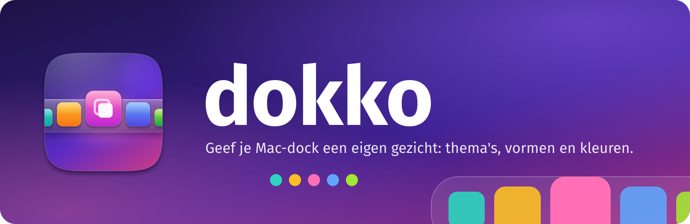

<p align="center"></p>

# Dokko

Dokko is een eigen, volledig themabare dock voor macOS, gebouwd met Swift en SwiftUI (macOS 13+).

macOS laat het echte Dock niet van kleur of vorm veranderen. Dokko tekent daarom een
eigen dock-venster onderaan het scherm en zet het echte Dock op autohide met een enorme
vertraging, zodat het niet in beeld komt. Bij afsluiten wordt het echte Dock hersteld.

## Functies

- **Thema's:** vorm, kleur, kleurverloop, glas-blur, rand, schaduw, marges, icoonvorm, labels.
  Zonder achtergrond kan ook, dan blijven alleen de iconen over.
- **Positie:** vrij verticaal (ook negatief, deels onder de schermrand) en horizontaal.
- **Hover:** vloeiende vergroting zoals het echte Dock, glow achter het icoon, andere iconen dimmen.
- **Animatie:** veerinstellingen, stuiteren bij openen van een app, fade bij verbergen.
- **Vensters van andere apps:** ruimte vrijhouden (vensters schuiven/krimpen boven de dock) of de dock
  slim verbergen als een venster erover ligt. De dock verdwijnt ook in volledig scherm.
- **Paletten:** negen ingebouwde paletten (Catppuccin, Gruvbox, Tokyo Night, Nord, ...), palet uit je
  wallpaper, en het wallpaper automatisch volgen.
- **Thema's als bestanden:** json in `~/.config/dockstudio/themes`, handig voor je dotfiles.
- **Hooks:** scripts in `~/.config/dockstudio/hooks` draaien bij een themawissel, met de kleuren als
  omgevingsvariabelen.
- **Home Assistant:** lampen, schakelaars en scènes als iconen in de dock, en lampen die de kleur
  van het thema overnemen.

## Bouwen en starten

Vereist: macOS 13 of nieuwer en het volledige **Xcode** (niet alleen de Command Line Tools).

```
sudo xcode-select -s /Applications/Xcode.app/Contents/Developer
swift run              # snel proberen
./build-app.sh         # maakt Dokko.app (menubalk-app)
```

Of open `Package.swift` in Xcode en druk op Run.

## Rechten

- **Toegankelijkheid:** nodig voor ruimte vrijhouden, slim verbergen en de volledig-scherm-detectie.
  Bij `swift run` geef je dit aan Terminal, bij `Dokko.app` aan Dokko.
- **Lokaal netwerk:** voor Home Assistant.
- **Sleutelhanger:** het Home Assistant-token wordt daar bewaard, nooit in een bestand of in git.

## Thema-bestand

```json
{
  "name": "Mijn thema",
  "style": "neon",
  "palette": {
    "background": "#282828",
    "foreground": "#ebdbb2",
    "accent": "#fabd2f"
  }
}
```

`style` is `glass`, `solid`, `neon` of `iconsOnly`. `surface` en `secondary` mogen ontbreken.

## Hooks

Uitvoerbare scripts (`chmod +x`) in `~/.config/dockstudio/hooks` krijgen deze variabelen:
`DOCKSTUDIO_THEME`, `DOCKSTUDIO_BG`, `DOCKSTUDIO_SURFACE`, `DOCKSTUDIO_FG`,
`DOCKSTUDIO_ACCENT`, `DOCKSTUDIO_SECONDARY`, `DOCKSTUDIO_WALLPAPER`.

## Als het echte Dock verborgen blijft (bijv. na een crash)

Kies "Herstel echte Dock" in het menubalk-icoon, of in Terminal:

```
defaults delete com.apple.dock autohide-delay
defaults delete com.apple.dock autohide-time-modifier
defaults delete com.apple.dock autohide
killall Dock
```

## Beperkingen

- Het systeem reserveert geen schermruimte voor Dokko; vensters worden via de Toegankelijkheids-API
  bijgestuurd (ongeveer 3 keer per seconde), dus er kan een korte "sprong" zichtbaar zijn.
- Werkt op het hoofdscherm. Bewegende wallpapers worden niet gelezen voor het palet.

## Ideeën

Dock links/rechts, slepen om de volgorde te wijzigen, rechtermuisklik-menu, audio-reactieve glow,
meerdere docks per Space, thema's die wisselen per tijd of app.
